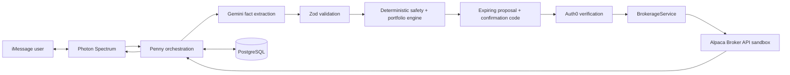

# Penny

Penny is an iMessage-first automated-investing prototype. It protects money needed for real life, builds a transparent Low/Medium/High proposal, requires an expiring confirmation plus Auth0 verification, executes virtual-money ETF orders through Alpaca Broker API sandbox, sends broker-backed weekly updates, and reassesses the mandate after a life event.

Penny is not an investing-education chatbot, stock picker, brokerage dashboard, or production investment adviser. For HackLanta II every balance, deposit, holding, gain/loss, and order is simulated. Penny never calls Alpaca production, moves real money, or collects bank credentials, tax IDs, or onboarding documents through Photon.

## Architecture



Photon/Spectrum remains the product interface. `/healthz`, terminal mode, and the existing image card are operational or presentation harnesses—not a conventional web product. Photon never handles Alpaca credentials or onboarding data.

Gemini may extract cash, protected expenses/dates, life events, risk, and requested action into a strict schema. It cannot calculate investable money, select securities, confirm a proposal, bypass protected funds, or place an order. Deterministic TypeScript makes those decisions.

## Judge flow

1. Text: “I received $100, but I need $60 for textbooks. Invest the rest at medium risk.”
2. Penny protects `$60` and proposes `$24` VTI, `$12` BND, and `$4` sandbox cash.
3. Reply with the exact expiring `CONFIRM <code>`. Ordinary assent or a poll tap is not approval.
4. Complete the proposal-bound Auth0 hosted verification.
5. Penny creates/retrieves the fictional Alpaca sandbox account, requests virtual funding if required, and submits idempotent notional market/day orders.
6. Penny returns the clearly simulated result and later retrieves Alpaca sandbox positions/value for a weekly Photon update.
7. Text: “My car broke down and I need $300.” Penny reassesses and proposes a change without liquidating or withdrawing until a new confirmation and verification.

See [DEMO.md](DEMO.md) for the exact three-minute sequence.

## Deterministic model portfolios

| Risk   | VTI diversified stocks | BND bonds | Sandbox cash |
| ------ | ---------------------: | --------: | -----------: |
| Low    |                    20% |       60% |          20% |
| Medium |                    60% |       30% |          10% |
| High   |                    85% |       10% |           5% |

Cash creates no order. Exact-cent order notionals cannot exceed deterministic capacity, current sandbox buying power, or the confirmed amount. No options, margin, leverage, shorts, crypto, or individual speculative stocks are used.

## Local setup

Requirements: Node.js 20+, npm, Photon Spectrum/iMessage, Gemini, Auth0, PostgreSQL, and Alpaca Broker API sandbox credentials.

```bash
npm ci
npm run check
npm run start:production
```

`start:production` applies `db/schema.sql` and migrations `002` through `004` before starting Spectrum. Copy variable names from `.env.example` into server-side/Replit Secrets. For judging use `PENNY_TRANSPORT=imessage`, `PENNY_INTERPRETER=gemini`, and `PENNY_BROKERAGE_PROVIDER=alpaca`.

Terminal diagnostics remain explicit local mode:

```bash
PENNY_TRANSPORT=terminal PENNY_INTERPRETER=local PENNY_BROKERAGE_PROVIDER=none npm run dev
```

## Service cost and access requirements

Pricing and free-tier rules change, so verify the linked provider pages before a demo or deployment. The status below was checked on October 11, 2026.

No feature in the current hackathon sandbox build was left out solely because of a service fee. A local demo can use free/open-source software and provider free tiers, but the full iMessage demo still needs accounts and credentials. “Free” also does not mean unlimited, approved for production, or appropriate for real financial data.

| Service                                                                                             | Hackathon availability                                                                                                                                                                            | What can require payment or approval                                                                                                                                                                                                                                                                                                                                                                                                                             |
| --------------------------------------------------------------------------------------------------- | ------------------------------------------------------------------------------------------------------------------------------------------------------------------------------------------------- | ---------------------------------------------------------------------------------------------------------------------------------------------------------------------------------------------------------------------------------------------------------------------------------------------------------------------------------------------------------------------------------------------------------------------------------------------------------------- |
| [Alpaca Broker API sandbox](https://docs.alpaca.markets/us/v1.1/docs/integration-setup-with-alpaca) | Alpaca documents sandbox development as free of charge. Signup with an email provides sandbox keys, and all sandbox funds and trades are virtual. Penny's genuine sandbox adapter is implemented. | A live Broker API launch requires Alpaca business onboarding, commercial terms, regulatory approval, and production credentials. Live market-data or higher-volume plans can have separate fees. None of that is required for this demo.                                                                                                                                                                                                                         |
| [Gemini Developer API](https://ai.google.dev/gemini-api/docs/pricing)                               | Google offers a limited free tier, so the structured-intent parser can run without API usage charges while the project remains within its model and rate quotas.                                  | Free-tier requests can be throttled or exhausted. Paid usage provides higher limits. Google's [API terms](https://ai.google.dev/gemini-api/terms) say unpaid-service inputs and outputs may be used to improve its products and may be reviewed, so the free tier must use fictional demo data—not real private financial details. A production Penny deployment should use an appropriately contracted data-processing tier or another approved model provider. |
| [Auth0](https://auth0.com/pricing)                                                                  | Auth0 lists a `$0/month` Free plan with no card required and up to 25,000 monthly active users. That is sufficient for the fictional judge flow, subject to the tenant's feature limits.          | Higher limits, production/development environment separation, advanced MFA, enterprise support, or other paid-plan features require an upgrade. Auth0 configuration and credentials are still required even on the free plan.                                                                                                                                                                                                                                    |
| [Photon Spectrum](https://github.com/photon-hq/spectrum-ts)                                         | The `spectrum-ts` SDK is open source under the MIT license and is already integrated. Terminal mode costs nothing and can exercise the conversation path without iMessage.                        | Spectrum Cloud is the hosted iMessage transport used by the judge flow and requires a Photon project ID/secret. Photon does not publish a stable public price on the linked SDK page, so this README does not claim hosted iMessage is free. Confirm the project's quota/plan in the Photon dashboard. Self-hosted/local iMessage is a possible future alternative but requires compatible Apple hardware and is not the configured primary transport.           |
| PostgreSQL                                                                                          | PostgreSQL itself is free/open source. Tests use the in-memory repository, and local development can use a local PostgreSQL installation without a service fee.                                   | A hosted database may consume Replit or another provider's paid resources. The authoritative financial state must remain server-side, so removing PostgreSQL merely to avoid hosting cost is not a safe option.                                                                                                                                                                                                                                                  |
| [Replit hosting and database](https://replit.com/pricing)                                           | Replit can be used for development and may include plan credits. It is not required by Penny's architecture; the same Node.js service and PostgreSQL schema can run elsewhere.                    | Always-on deployment, compute, outbound traffic, and hosted PostgreSQL can consume credits or incur usage charges. Replit's current public plans are paid, so do not assume production hosting is free. Set a spend limit or run locally for a no-hosting-cost demo.                                                                                                                                                                                             |
| Node.js dependencies                                                                                | The packages in `package.json` are installable without per-request fees.                                                                                                                          | Normal hosting/network costs still apply. Package availability does not include accounts or quotas for the external services they call.                                                                                                                                                                                                                                                                                                                          |

Cost is not the reason real-money trading, KYC/AML, custody, tax reporting, regulated advice, and production brokerage operations are absent. Those capabilities require legal authority, compliance programs, business agreements, operational controls, and a production security review in addition to budget. They must not be represented as unlockable merely by adding a credit card.

For the lowest-cost judge setup, run Penny on existing/local compute with PostgreSQL, use fictional data with Gemini's free quota, use Auth0 Free, and use Alpaca's free sandbox. Photon Cloud access is the one demo dependency whose current cost/quota must be confirmed in the project dashboard. If a provider quota is unavailable, terminal mode remains a free diagnostic path, but it is not a substitute for the required final iMessage demonstration.

### Photon and Gemini

Set `SPECTRUM_PROJECT_ID`, `SPECTRUM_PROJECT_SECRET`, and `GEMINI_API_KEY`. Spectrum 12.2.0 provides the async iMessage stream, typing, tapbacks, threaded replies, polls, attachments, and proactive sends. Gemini returns schema-constrained JSON; malformed or low-confidence output changes no financial state and never reaches the broker.

### Auth0

Create an Auth0 Native Application with Device Code enabled and an API audience. Set `AUTH0_DOMAIN`, `AUTH0_CLIENT_ID`, and `AUTH0_AUDIENCE`. Penny verifies issuer/audience/signature/expiry and binds the subject to the exact user and proposal.

### Alpaca Broker API sandbox

Set:

```dotenv
PENNY_BROKERAGE_PROVIDER=alpaca
ALPACA_BROKER_BASE_URL=https://broker-api.sandbox.alpaca.markets
ALPACA_BROKER_API_KEY=
ALPACA_BROKER_API_SECRET=
ALPACA_DEMO_ACCOUNT_ID=
ALPACA_DEMO_ACH_RELATIONSHIP_ID=
```

Use one clearly fictional sandbox account. Alternatively set the server-only `ALPACA_DEMO_ACCOUNT_APPLICATION_JSON` and explicitly create it:

```bash
npm run alpaca:sandbox -- account
```

The separately authorized smoke command requests `$1` of virtual funding and a `$1` VTI sandbox order:

```bash
PENNY_ALLOW_SANDBOX_WRITE=true npm run alpaca:sandbox -- smoke
npm run test:alpaca:sandbox
```

Alpaca exposes no universal account-reset operation; `npm run alpaca:sandbox -- reset` fails safely and directs the operator to create a fresh fictional sandbox account or use Brokerdash. Penny never synthesizes a successful deposit, fill, or reset.

## Persistence, idempotency, and privacy

PostgreSQL stores users, Photon/Auth0 links, mandates, expenses, proposals/confirmations, Alpaca account and transfer references, order/client IDs and statuses, last-known snapshots, message receipts, memory, and append-only audit events. Alpaca remains authoritative for current sandbox brokerage state.

Provider message IDs, transfer keys, and deterministic client order IDs prevent duplicate effects. A changed amount, risk, protected expense, mandate version, or expired code invalidates confirmation. Logs and audit payloads exclude raw messages, API keys, access tokens, bank/tax identity, and complete Auth0 subjects.

`FakeBrokerageAdapter` is available only for automated tests and explicitly labelled non-production development. There is no fallback from expected Alpaca mode to fake data. `NODE_ENV=production` rejects the fake adapter, and every Alpaca mutating call rechecks the exact sandbox origin.

## Verification

```bash
npm run format:check
npm run typecheck
npm test
npm run build
npm run smoke
```

The default suite mocks external networks. It covers protected/zero capacity, exact `$24/$12/$4` allocation, order caps, missing/expired/modified confirmation, duplicate delivery/confirmation, invalid model isolation, life-event reassessment, broker-backed weekly data, safe Alpaca errors, production-host rejection, persistence, identity, and credential non-disclosure. The credentialed sandbox test is opt-in and skipped by default.

## Real versus simulated

- Real in the demo: Photon message transport, Gemini structured extraction, Zod validation, deterministic safety/allocation, Auth0 verification, PostgreSQL records, and authenticated HTTP requests to Alpaca Broker API sandbox.
- Simulated: money, deposits, account holdings, fills, gains/losses, and the fictional account identity inside Alpaca sandbox.
- Not implemented: real-money custody/funding/trading, production endpoints, KYC through iMessage, tax/reporting workflows, or regulated advisory/compliance operations.

## Regulated future

A real deployment requires regulated brokerage/custody/advisory partners; KYC/CIP and AML/sanctions controls; agreements and disclosures; suitability/fiduciary governance; best execution and supervision; reconciliation and books/records; tax handling; complaints, incident, privacy, cybersecurity, and business-continuity programs; and jurisdiction-specific legal review. This hackathon build is not production-ready or licensed to manage real customer money.

## Project map

```text
src/application/                 conversation, confirmation, execution orchestration
src/brokerage/                   provider-neutral service, Alpaca, fake, deterministic models
src/domain/                      safety and portfolio rules
src/interpreter/                 Gemini/Zod boundary
src/repository/                  in-memory tests and PostgreSQL persistence
src/transport/spectrum.ts        iMessage-native Photon experience
db/migrations/004_brokerage_integration.sql
specs/brokerage-integration/     specification, plan, verified tasks
DEMO.md                          three-minute judge sequence
```
