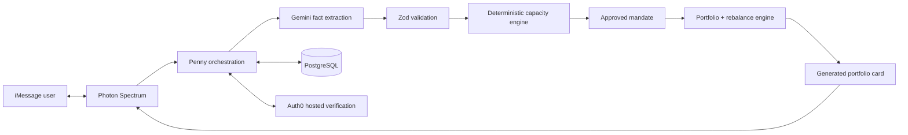

# Penny

> Tell Penny what is happening in your life, choose how much risk you are comfortable with, and Penny handles the investing work for you.

Penny is an iMessage-first robo-investor for beginners. It protects money needed for real life, builds a diversified paper portfolio from a Low/Medium/High mandate, manages and rebalances it automatically, sends visual weekly updates, and adapts when the user reports a raise, bonus, rent increase, tuition bill, or car repair.

For HackLanta II every balance, return, allocation, and transaction is simulated. Penny moves no money, accepts no deposits, connects to no brokerage, and collects no bank credentials. Education is available when requested, but the core product is automated portfolio management—not a course, quiz, stock picker, or “should I invest?” chatbot.

## The entire product lives in iMessage

There is no website, dashboard, browser chat, or React frontend. [Photon Spectrum](https://photon.codes/docs/spectrum-ts) 12.2.0 provides typing indicators, tapbacks, threaded replies, native polls, image attachments, and proactive messages. Auth0 uses its hosted Device Authorization experience for consequential approvals.

The judge flow is:

1. Text: “I have $100 and I want you to handle investing it for me.”
2. Tell Penny: “I’ll need around $60 for textbooks in January.” Penny protects `$60.00` and computes `$40.00` investable.
3. Select **Medium risk** in a native iMessage poll.
4. Review a generated portfolio image: 60% diversified equities, 30% diversified bonds, 10% simulated cash equivalent.
5. Select **Approve plan** and verify through Auth0’s hosted flow.
6. Penny applies seeded market movement, rebalances above 5 percentage points of drift, and records every simulated transaction.
7. Penny proactively sends a visual weekly update.
8. Text: “My car broke down and repairs might cost $300.” Penny remembers the existing mandate and offers a native pause/withdraw/continue poll. Nothing changes before approval and verification.



Gemini has no authority to calculate investable cash, choose allocations, simulate trades, invent balances/returns, or change stored facts. TypeScript engines make those decisions deterministically and persist reason codes and audit records.

## Sponsor-track fit

- **Fintech:** living mandates, deterministic cash protection, diversified model portfolios, automatic rebalancing, simulated transaction history, and weekly snapshots.
- **Photon Agents in iMessage:** Spectrum is the only product interface; native typing, tapbacks, replies, polls, generated image attachments, and proactive updates are used deliberately.
- **Best Use of Gemini API:** schema-constrained natural-language fact and life-event extraction, with Zod validation and fail-closed behavior.
- **Best Use of Auth0:** hosted identity verification gates first activation, risk changes, contribution changes, pause/resume, withdrawals, and resets.

## Model portfolios

| Risk   | Diversified equities | Diversified bonds | Simulated cash equivalent |
| ------ | -------------------: | ----------------: | ------------------------: |
| Low    |                  20% |               60% |                       20% |
| Medium |                  60% |               30% |                       10% |
| High   |                  85% |               10% |                        5% |

These are configurable hackathon simulations, not investment recommendations. Allocation uses exact integer cents. Seeded per-asset weekly returns keep the demo reproducible and independent of market APIs. Drift above `500` basis points triggers an automatic rebalance inside the approved mandate; mandate changes still require the user.

## Local setup

Requirements: Node.js 20+, npm, a Photon Spectrum project/iMessage line, Gemini API key, Auth0 tenant, and PostgreSQL for deployed use.

```bash
npm ci
psql "$DATABASE_URL" -f db/schema.sql
psql "$DATABASE_URL" -f db/migrations/002_persistent_memory.sql
psql "$DATABASE_URL" -f db/migrations/003_robo_portfolios.sql
npm run check
npm start
```

Copy the names from `.env.example` into Replit Secrets. Keep `PENNY_TRANSPORT=imessage` and `PENNY_INTERPRETER=gemini` for judging. Terminal mode is diagnostics only:

```bash
PENNY_TRANSPORT=terminal PENNY_INTERPRETER=local npm run dev
```

### Photon

Set `SPECTRUM_PROJECT_ID` and `SPECTRUM_PROJECT_SECRET`. The transport uses the installed Spectrum 12.2.0 API verified from its shipped declarations: `space.responding()`, `message.react("like")`, `message.reply()`, `poll()`, `poll_option`, `attachment()`, and persisted-space lookup for proactive sends. Photon’s current docs describe named tapback constants in newer releases; 12.2.0 accepts the supported `"like"` reaction string directly.

### Gemini

Set `GEMINI_API_KEY` and optionally `GEMINI_MODEL`. Penny requests JSON matching `InterpretationSchema`, treats user content as untrusted, and validates the response with Zod before any financial transaction. Malformed, missing, ambiguous, or low-confidence data produces clarification and no state change.

### Auth0

Create an Auth0 Native Application with Device Code enabled and an API audience. Set `AUTH0_DOMAIN`, `AUTH0_CLIENT_ID`, and `AUTH0_AUDIENCE`. Penny sends the hosted verification URL/code in iMessage, respects Auth0 polling intervals, verifies the returned JWT issuer/audience/signature/expiry, and binds the subject to the exact user and proposal. The intentional limitation is that the user briefly opens Auth0’s hosted page; Penny has no custom auth site.

## Replit deployment

1. Import the GitHub repository and add secrets.
2. Provision PostgreSQL and apply all three schema/migration files in order.
3. Build with `npm ci && npm run build`; run with `npm start`.
4. Use one always-on Reserved VM worker for the Spectrum stream and scheduler.
5. Set `PORT` only if Replit monitoring needs `/healthz`; it exposes status, not a product UI.
6. The scheduler checks hourly by default and sends only when the persisted last snapshot is at least seven days old. `PENNY_UPDATE_DELAY_MS` can shorten the post-approval demo update.

## Persistence, privacy, and reliability

PostgreSQL is the source of truth for users, Photon/Auth0 identity links, mandates, expenses, income changes, goals, proposals, positions, transactions, rebalancing events, weekly snapshots, message receipts, concise memory, and audit events. Each inbound message reloads this context before Gemini runs. Provider message IDs and logical-operation IDs prevent duplicate state changes. Two users cannot share records, even in the same space.

“What do you remember about me?” returns a mandate summary. “Forget me” deletes the user’s financial profile, portfolio, facts, proposals, snapshots, and memory; security/idempotency records are anonymized and retain no financial content. Logs use hashed references and never include message bodies, credentials, tokens, or full financial payloads.

## Verification

```bash
npm run format:check
npm run typecheck
npm test
npm run build
npm run smoke
```

The suite covers `$100 - $60 = $40`, all three model portfolios, exact cents, drift/no-drift rebalancing, seeded updates, bonuses, raises, car repairs, zero capacity, prompt-injection resistance, malformed model output, duplicate delivery, restart persistence, two-user isolation, unverified withdrawal protection, memory recall, deletion, and cross-identity rejection.

## Regulated future

The production vision connects the same conversational, mandate, and portfolio-orchestration layers to licensed investment advisers, brokerages, and qualified custodians. Real deployment would additionally require KYC/AML, disclosures and agreements, suitability/fiduciary controls, best execution, supervision, books and records, tax handling, privacy/security programs, incident response, and jurisdiction-specific legal review. This hackathon code does not satisfy those obligations.

## Project map

```text
src/application/                 conversation and authorization orchestration
src/domain/safety.ts             deterministic financial-capacity rules
src/domain/portfolio.ts          allocation, market steps, drift, rebalancing
src/interpreter/                 Gemini/Zod boundary
src/repository/                  in-memory tests and PostgreSQL persistence
src/transport/spectrum.ts        iMessage-native Photon experience
db/migrations/003_robo_portfolios.sql
specs/penny-robo-investor/       constitution, specification, plan, tasks
docs/                            architecture, demo script, Devpost copy
```
