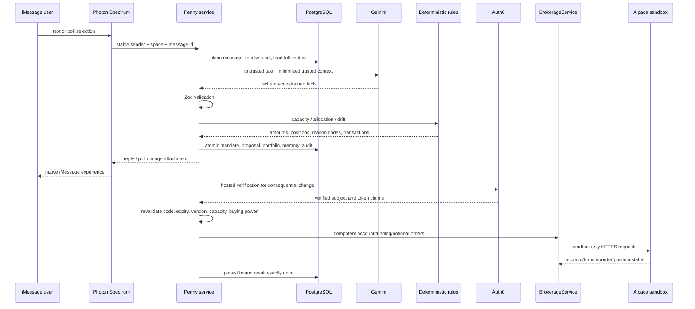

# Penny architecture

## Trust boundaries

- Message text, attachment names, poll payloads, URLs, and model output are untrusted.
- Gemini extracts facts only. It cannot calculate capacity, allocate assets, simulate returns, or mutate state.
- Zod validation occurs before a repository transaction can write financial state.
- The capacity and portfolio engines are pure deterministic TypeScript.
- Auth0 challenges bind action, user/resource, mandate version, and expiry; subject changes fail closed.
- Exact `CONFIRM <code>` is parsed deterministically and bound to an unexpired proposal; ordinary assent and poll taps are not approval.
- `BrokerageService` caps notional orders and the Alpaca adapter rejects every non-sandbox origin.
- Raw messages, tokens, credentials, Auth0 subjects, and financial payloads are excluded from logs.

## State and idempotency

PostgreSQL stores normalized users, mandates, expenses, income changes, goals, proposals, confirmation state, brokerage accounts/transfers/orders/snapshots, local presentation portfolios, conversation memory, audit events, and message receipts. The legacy JSON documents remain mirrored for backward-compatible reads. Every table carrying user data is keyed or foreign-keyed to one Penny user.

Inbound provider message IDs are claimed before interpretation. Failed transactions release the claim for retry; completed ones cannot repeat an effect. Proposals use message-derived idempotency keys. Transaction and weekly snapshot IDs are stable for their logical operation. The weekly scheduler calculates due work from persisted timestamps, so process restarts do not reset the schedule.

## Portfolio lifecycle

1. The capacity engine computes protected and investable cents from stored facts.
2. A risk poll selects a configured Low/Medium/High model.
3. Exact-cent positions and initial-allocation transactions are created as a pending proposal preview.
4. Auth0 verification activates the version-bound proposal.
5. Each week applies seeded returns separately to equities, bonds, and cash equivalent.
6. If maximum allocation drift exceeds 500 bps, exact target positions and rebalance transactions are recorded automatically.
7. A weekly snapshot feeds the generated SVG attachment and concise text summary.
8. Life events create new proposals; no risk, contribution, pause/resume, withdrawal, or reset change occurs without verification.

## Native iMessage mapping

- `space.responding()` — typing indicator with SDK-managed cleanup.
- `message.react("like")` — immediate tapback acknowledgment in Spectrum 12.2.0.
- `message.reply()` — replies tied to the source message, especially life events.
- `poll()` / inbound `poll_option` — risk, plan, contribution, pause, and withdrawal choices.
- `attachment(Buffer, { mimeType: "image/svg+xml" })` — backend-generated portfolio card.
- persisted `photonSpaceId` + `imessage(app).space.get()` — proactive weekly delivery.

## Failure behavior

Gemini failure or malformed output changes no financial state. Message-domain mutations and receipt completion commit atomically, and verified actions run in one database transaction. Auth0 expiry/mismatch changes nothing. If delivery fails after a commit, Penny says that the request was saved and directs the user to recall the plan instead of replaying the mutation. Seeded data removes live-market dependency. The terminal transport and `/healthz` are diagnostics only, never alternate judged interfaces.
