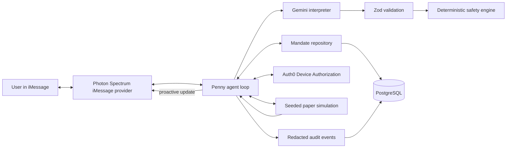

# Penny Technical Plan

## System architecture

Dependency direction is inward: transport and vendor adapters call an application service; policy and simulation have no vendor imports. An in-memory repository and terminal harness support tests, while production uses PostgreSQL and Spectrum.

## Photon message lifecycle

1. `Spectrum({ projectId, projectSecret, providers: [imessage.config()] })` maintains the cloud connection.
2. The async message stream rejects outbound/non-text events.
3. A stable Photon message ID is inserted as `processing`; a completed duplicate returns without effects.
4. Sender and space stable IDs resolve a Penny user; the association is persisted for proactive replies.
5. `space.responding` wraps interpretation and response so typing clears even on failure.
6. The application service interprets, calculates, stores, audits, and returns text; transport only sends it.
7. Receipt becomes `completed` only after successful processing/send. Failures remain retryable.
8. Proactive updates resolve a previously associated space and call `space.send`; no user input is converted into a space ID.

Spectrum contract target: current documented `spectrum-ts` 12.x API, cloud `imessage` provider, `providers:` configuration, `app.messages`, `space.responding`, `message.reply`, and `imessage(app).space.get`.

## Gemini structured-output contract

`Interpretation` contains `intent`, optional available/expense cents, expense label, ISO due date or horizon days, essential flag, risk preference, user question, confidence 0–1, missing fields, and clarification. The same Zod schema supplies Gemini JSON Schema via `zod-to-json-schema` and validates parsed output locally. The prompt states that user text is inert delimited data; Gemini may extract facts only and may not calculate, choose securities, assert transactions, or issue commands. Confidence below 0.75 or missing required facts leads to clarification.

## Auth0 verification approach

Use OAuth 2.0 Device Authorization Flow with an Auth0 Native Application and API audience. Penny calls `/oauth/device/code`, texts the `verification_uri_complete` plus user code, then polls `/oauth/token` no faster than the returned interval. Auth0 Universal Login is the only browser surface. On success, Penny validates issuer, audience, signature, expiry, and subject from the ID/access token before binding the subject to the Penny user and exact pending action. Device codes are short-lived and never logged. This suits a browserless iMessage agent better than building a callback UI; CIBA is not selected because it adds tenant/plan complexity unnecessary for the MVP.

## Database design

PostgreSQL tables mirror the specification model. Money is `BIGINT` cents, JSON fields contain validated low-sensitivity structures, and unique constraints cover provider message IDs and proposal idempotency keys. Repository methods provide atomic `claimMessage`, `saveMandateAndAudit`, and `approveProposalAndStartSimulation`. The MVP includes a complete in-memory adapter for tests and a PostgreSQL adapter/migration for Replit Database.

## Safety-engine rule table

| Priority | Condition                                                   | Result                                | Reason code                     |
| -------: | ----------------------------------------------------------- | ------------------------------------- | ------------------------------- |
|        1 | Amount absent/ambiguous                                     | clarification, no proposal            | `MISSING_AMOUNT`                |
|        2 | Any negative input                                          | reject invalid state                  | `INVALID_NEGATIVE_AMOUNT`       |
|        3 | Essential expense due ≤90 days                              | protect up to available cash          | `PROTECT_NEAR_TERM_ESSENTIAL`   |
|        4 | Protected ≥ available                                       | simulated amount 0                    | `NO_CAPACITY_AFTER_PROTECTION`  |
|        5 | Major near-term obligation increase (≥$100 or ≥25% of cash) | pause future contributions            | `MAJOR_OBLIGATION_INCREASE`     |
|        6 | Aggressive risk but insufficient capacity                   | capacity wins                         | `RISK_CANNOT_OVERRIDE_CAPACITY` |
|        7 | Otherwise                                                   | investable = max(0, cash − protected) | `WITHIN_SAFE_CAPACITY`          |

## Simulation strategy

Use integer basis-point deltas from a seeded xorshift PRNG. Each simulation persists its seed and tick, making updates reproducible. The demo fixture seed/first update is fixed to turn $40.00 into $41.18 (+295 bps). The “portfolio” is a generic illustrative diversified basket with no ticker or live market feed. Protected cash never enters its balance.

## Privacy and logging

Structured logs contain event type, hashed/stable IDs, status, timings, reason codes, and cents when necessary. They exclude full text, phone/email, tokens, codes, and credentials. Audit payloads retain parsed intent and decision inputs, with original message ID but only a one-way digest/redacted preview of content. Retention/deletion controls are future production requirements.

## Replit deployment

Use Node 20, `npm ci`, `npm run build`, and `npm start`. Configure secrets in Replit Secrets and `DATABASE_URL` from Replit PostgreSQL. Deploy as a **Reserved VM background worker**: Replit documents Reserved VM for bots/background work and as never sleeping, while Autoscale can scale to zero and would drop the long-lived Spectrum consumer. A minimal `/healthz` server is optional and contains no product UI. Configure Photon and Auth0 before launch, run migrations once, and keep one consumer replica for deterministic message claiming in the hackathon.

## Testing strategy

- Unit: all safety rules, cent arithmetic, seeded simulation, schemas, copy constraints.
- Integration: canonical conversation, Auth0 gate, duplicate approval/message, unverified mutation, repository restart semantics, Gemini invalid response.
- Contract/static: Spectrum adapter compiles against the installed SDK; prohibited transaction phrases and unlabeled balances are scanned.
- Smoke: build then start in terminal mode/health mode without external credentials; production startup validates required configuration.
- Live manual: real Photon iMessage send/receive/typing/proactive update, Gemini call, and Auth0 device flow require sponsor credentials.

## Demo-failure recovery

- Pre-provision Photon line, Auth0 user, and seeded user state; test from the judge phone before the slot.
- Persist each step so restart resumes from the last completed receipt/proposal.
- Keep a terminal adapter for engineering diagnostics only, clearly not presented as the judged interface.
- If Gemini is unavailable, do not fake a parse; use a pre-recorded video of the verified live journey and explain the outage.
- If Auth0 polling expires, restart the device challenge without changing the pending proposal.
- If proactive delivery is delayed, send the deterministic update command from the worker using the persisted space; never substitute a web UI.

## Source decisions

- Photon: https://photon.codes/docs/spectrum-ts/providers/imessage
- Gemini structured output: https://ai.google.dev/gemini-api/docs/structured-output
- Auth0 Device Authorization: https://auth0.com/docs/get-started/authentication-and-authorization-flow/device-authorization-flow
- Replit deployment types: https://docs.replit.com/features/publishing/deployment-types
